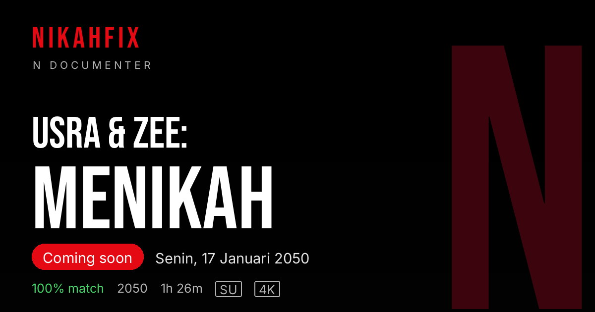

# NikahFix

A digital wedding invitation for Usra & Azizi Asadel ("Usra & Zee"), styled after Netflix. Guests pick their own name on the opening screen to enter the invitation addressed to them.

**Live:** https://nikahfix.xsrazy.web.id

## About

NikahFix turns a wedding invitation into a streaming-service experience. Instead of a generic link, every guest opens the invitation through a Netflix-style profile picker, so the invitation they see is addressed to them personally.

The featured title is "Usra & Zee: Menikah", marked as coming soon on Monday, 17 January 2050: an intimate wedding in "Antah-berantah", attended only by family and the closest people.

## Features

- "Who's Watching" opening screen: the guest taps their name (CLICK YOUR NAME) to open their invitation, mimicking the Netflix profile picker
- Personalized invitation content with the wedding event details for the guest who opened it
- Title page styled like a streaming original: "100% match", an "SU" maturity rating, "2050 · 1h 26m", 4K badges, and a red "Coming soon" banner
- "Our Love Story" presented as an episode picker: three episodes plus a "[Coming Soon] Final Episode: The Beginning of Forever"
- "Breaking News", "Bride and Groom", and "Our Love Gallery" sections
- Wishes: guests can write greetings and well-wishes, and the list is shown on the page
- Netflix-style visual theme: dark interface with red accents
- Sharing-ready: full SEO metadata, Open Graph and Twitter cards with a custom Netflix-poster share image, plus robots.txt and a sitemap (added October 2026)

## Architecture

- Frontend: Vite + React single page application with Tailwind CSS, React Router, Axios, React Player, and Lucide icons. This repository contains only the frontend
- Backend: a separate repository, `nikahfix-be-v2` (Express + Supabase). It stores wishes in the `wishs` table of the `nikahfix` Supabase project and provides the endpoints to submit and read wishes
- Access lock: the backend only serves requests whose Origin or Referer is nikahfix.xsrazy.web.id, nikahfix.web.id, this project's Vercel deployments, or localhost; requests from other origins are rejected with 403
- Hosting: Vercel. The project is connected to this repository, so pushes to `main` deploy automatically

## Notes

- At the last check, 11 wishes were stored in the backend

## Credits

NikahFix is based on the open-source NikahFix project originally created by [janexmgd](https://github.com/janexmgd). Thank you to the original author for building the template this site is based on.

## License

MIT. See [LICENSE](LICENSE).
